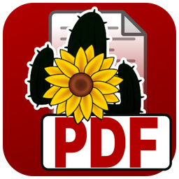
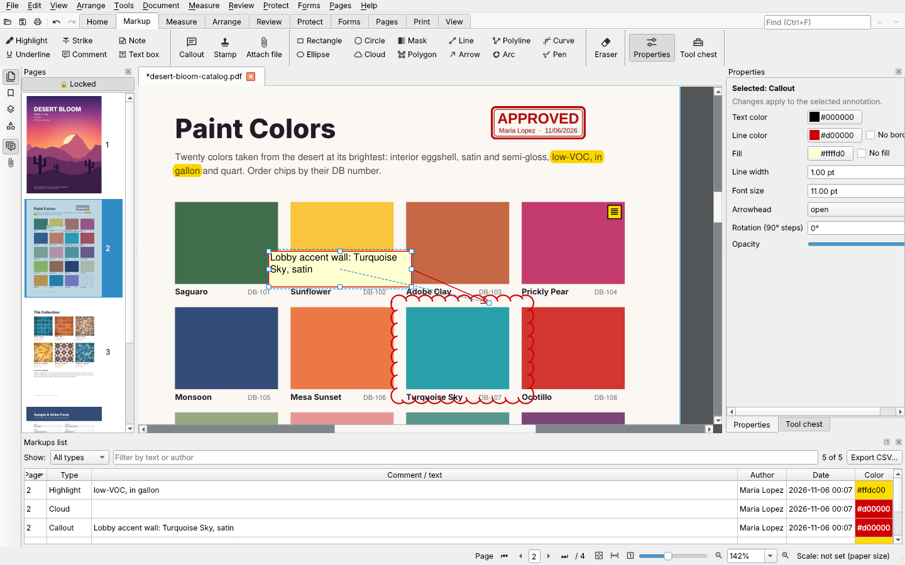
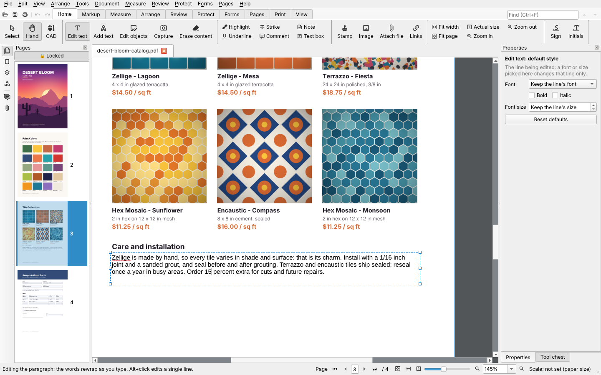
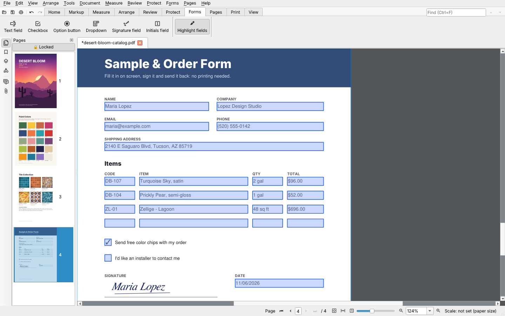
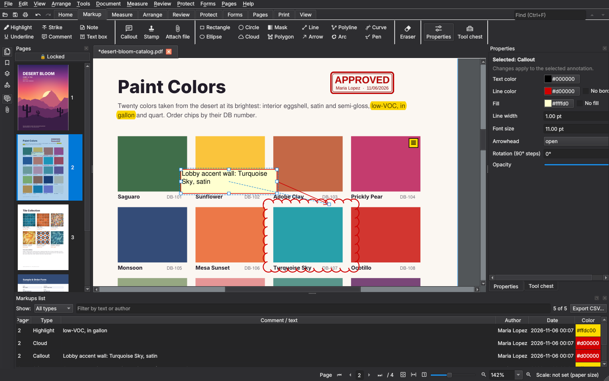
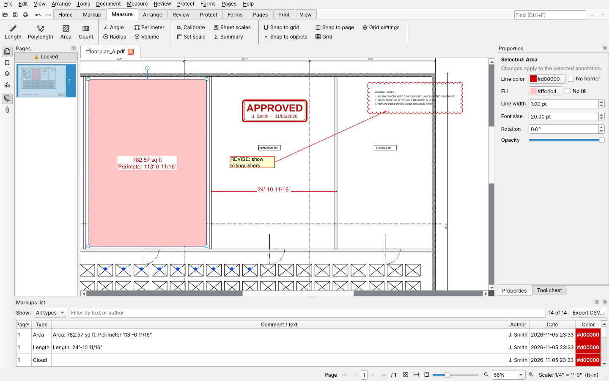

<p align="center">
  
</p>

<h1 align="center">KanzonasPDF</h1>

<p align="center">
  <b>A free, open-source PDF viewer and editor for Windows and Linux</b><br>
  Read, comment, edit, fill in, sign, protect and print PDFs. No account, no subscription,<br>
  no watermarks, no telemetry. Installer or portable.
</p>

<p align="center">
  <a href="https://github.com/keithlyding/KanzonasPDF/releases"><b>Download for Windows and Linux</b></a> ·
  <a href="#getting-started">Getting started</a> ·
  <a href="#feedback">Report a bug</a> ·
  <a href="CODE_SIGNING_POLICY.md">Code signing policy</a>
</p>

> Used daily for real work. Every release passes 1,000+ automated tests and a self-test of the
> built program on Windows and Linux before it's published, and reported bugs have been fixed within days.



## Who it's for

Anyone who works with PDFs and wants a capable editor without a license or a subscription:
reviewing and commenting on documents, filling in and signing forms, fixing a typo in a PDF's
own text, combining and reorganizing pages, redacting before sharing, or turning scans into
searchable text. A free alternative to Adobe Acrobat Pro and PDF-XChange Editor, and, for
people who mark up and measure drawings, to Bluebeam Revu.

| | KanzonasPDF | Adobe Acrobat Pro | PDF-XChange Editor | Bluebeam Revu |
| --- | --- | --- | --- | --- |
| Price | Free, open source (AGPL) | Subscription, or a 3-year license (Acrobat Pro 2024) | Free (its paid features add watermarks), or a license | Annual subscription |
| Edit page text and objects | Yes (paragraphs rewrap) | Yes | Yes | Limited |
| Fill in and sign forms | Yes | Yes | Yes | Yes |
| Compare revisions | Yes | Yes | Yes | Yes |
| Calibrated measuring (length, area, volume, count) | Yes | Basic | Yes | Yes |
| Portable (USB stick, nothing in the registry) | Yes | No | Yes | No |
| Runs offline, no account | Yes | Account | Yes | Account |

**All of it free, with no watermarks, no account and nothing uploaded:** comments and markups,
editing the PDF's own text, pictures and shapes, fillable forms, signatures and digital
signatures, OCR, redaction, passwords, page tools, compare, export to Word, Excel and
PowerPoint, and printing with a preview. It runs from a USB stick too, or as a PortableApps.com
package, and speaks English and Spanish.

**Missing something you rely on in Acrobat or another editor?** [Tell us](#feedback). That's
how most of the features below got here.

<p align="center">
  
  
</p>

## What it does

**Read and navigate**
- Tabs, fast scrolling and zoom even on very large pages, page thumbnails, bookmarks, layers
- Find with every match highlighted; split view to see two places at once
- Light, dark or match-system theme; ribbon or classic toolbars; a command palette (Ctrl+Shift+P)

**Comment and mark up**
- Highlight, underline, strike out, comment on text, sticky notes, text boxes, callouts
- Rectangles, ellipses, revision clouds, polygons, lines, arrows, freehand pen
- Stamps (Approved, Reviewed, Draft and more, or your own), with your name and the date
- A tool chest of saved markup styles, and a markups list you can filter and export
- Markups are standard PDF annotations, so Acrobat and other viewers see them too

**Edit the PDF itself**
- Edit text in place: click a paragraph and type, and the words rewrap; find and replace text
- Move, resize, rotate or delete the page's own pictures and shapes; add text and pictures
- Erase content in an area, add backgrounds, watermarks, headers and footers, page numbers and
  Bates numbering, and links on anything

**Fill in and sign**
- Fill in forms, and create them (text fields, checkboxes, option buttons, dropdowns,
  signature fields)
- Your signature and initials (drawn or scanned) and the date, placed anywhere or in a field
- Digital signatures with a certificate, which prove the file hasn't changed since

**Protect, redact and recognize text**
- Passwords and permissions
- Redaction removes marked text and, by default, scrubs metadata, attachments, hidden text and
  scripts. It is not a proven redaction corpus: check the result before sharing.
- Recognize text (OCR) in scanned pages, offline, so they can be searched and copied

**Pages, compare and convert**
- Rotate, reorder, insert, extract, crop and delete pages; combine files; make a PDF from images
- Compare documents: word by word for text that reflows, or laid over each other for drawings
- Export to Word, Excel, PowerPoint, images and text

**Print**
- Print with a preview, sharp even for large sheets
- Print production for print shops: trim, bleed and art boxes, crop marks, fixing hairlines too
  thin to print, and a check for common printing problems (fonts not embedded, low-resolution
  or RGB pictures, mixed sheet sizes)

**For drawings and plans**
- Set the scale from a preset (1/4" = 1'-0", 1:100, ...), by calibrating a known dimension, or
  from the sheet's title block
- Length, polylength, area, perimeter, volume, angle, radius and counts, with snapping and a
  measurement summary you can export to CSV
- Compare two revisions of a sheet, with every change clouded; links from sheet callouts to the
  sheets they name
- And, for fun, a CAD mode with AutoCAD-style move, copy, rotate, trim and a command line, plus
  a night mode (white lines on black) and export to AutoCAD DXF

**Built to stay fast and light:** it starts in well under a second, and every build checks
start-up time and memory automatically. There's no background service, no account and no
telemetry. It only goes online to check whether a newer version exists (you can turn that off)
and, if you add a trusted timestamp to a digital signature, to contact a timestamp server.

<p align="center">
  
  
</p>

## Download and install

Download from the [Releases page](https://github.com/keithlyding/KanzonasPDF/releases).
Pick **one** of these files from the newest release:

| File | What it is |
| --- | --- |
| `KanzonasPDF-v…-setup.exe` | **Installer (recommended).** No administrator rights needed. It can add a desktop shortcut and offer KanzonasPDF as an app for opening PDFs. |
| `KanzonasPDF-portable.zip` | **No installation.** Unzip anywhere (even a USB stick) and run `KanzonasPDF.exe`. Settings, signatures and stamps stay in a `data` folder next to it. To update, unzip the new one over the same folder: the program keeps the same path, so it stays your default PDF app. |
| `KanzonasPDF-windows.zip` | The same program as the portable version, but it keeps its settings in your Windows profile. |

Also available as a [PortableApps.com](https://portableapps.com/) package
(`KanzonasPDFPortable_<version>_English.paf.exe` on the Releases page, in testing on their
forum) and, soon, through `winget` (the manifests are in [`packaging/winget`](packaging/winget)).

### "Windows protected your PC"

KanzonasPDF isn't code-signed yet (see the [code signing policy](CODE_SIGNING_POLICY.md)), so
Windows SmartScreen may warn you the first time you run it, simply because it doesn't recognize
a new program yet. To run it anyway, click **More info**, then **Run anyway**. Even signed, a
new program can see this warning for a while, until Windows has seen enough people run it safely.

Only do this with files downloaded from this project's
[Releases page](https://github.com/keithlyding/KanzonasPDF/releases). Every release is built
from the public source code in this repository by GitHub's own build servers and tested there
before it's published, and every release lists the SHA-256 checksum of each download
(`SHA256SUMS.txt`), so you can check that what you downloaded is what was built:
`Get-FileHash <file>` in PowerShell.

### Updating and uninstalling

- KanzonasPDF tells you when a newer version is out (Help > Check for updates...). It only
  tells you; it never installs anything by itself.
- To update, run the new installer: it replaces the old version and keeps your settings,
  signatures, stamps and tool chest.
- To uninstall, use Windows Settings > Apps.

### Linux (AppImage)

KanzonasPDF also runs on Linux (64-bit x86 PCs) as a single file that needs no installation and
no administrator rights:

1. Download **`KanzonasPDF-x86_64.AppImage`** from the newest release on the
   [Releases page](https://github.com/keithlyding/KanzonasPDF/releases). Put it where you keep
   programs, for example a folder `~/Applications` in your home folder.
2. Make it executable: right-click it > Properties > Permissions > "Allow executing file as
   program", or in a terminal:

   ```sh
   chmod +x KanzonasPDF-x86_64.AppImage
   ```

3. Double-click it, or run `./KanzonasPDF-x86_64.AppImage` (add PDF files after it to open them).

**If it doesn't start ("FUSE" / "libfuse.so.2" error):** AppImages need FUSE 2, which newer
distributions don't install by default. On Ubuntu 22.04 and Debian 12:
`sudo apt install libfuse2`; on Ubuntu 24.04 and later: `sudo apt install libfuse2t64`; on
Fedora: `sudo dnf install fuse-libs`. Or, without installing anything, run it as
`./KanzonasPDF-x86_64.AppImage --appimage-extract-and-run` (it starts a little slower).

**Applications menu and default PDF app:** in KanzonasPDF, open File > Preferences > General
and tick **Add KanzonasPDF to the applications menu and open PDFs with it**. This adds a menu
entry and icon for your user only (in `~/.local/share`) and makes KanzonasPDF the app that opens
PDF files. Unticking it takes them away again. Keep the AppImage where it was when you added it
(if you move it, start it once from its new place and the menu entry follows it).

**Updating:** when a new version is out, KanzonasPDF tells you (Help > Check for updates...).
**Update now** downloads the new AppImage, checks its SHA-256 against the release, asks you to
save your work, puts it in place of the old file (same name, same place, so the menu entry and
default app keep working) and starts it again. If the AppImage is in a folder you can't change
(for example one owned by root), it opens the release page instead: download the new file and
replace the old one yourself. Your settings are kept.

**Where your things are:** settings in `~/.config/KanzonasPDF/KanzonasPDF.conf`; signatures,
stamp pictures, your certificate and backups in `~/.local/share/KanzonasPDF/KanzonasPDF`.

**Removing:** untick the Preferences option above (or delete
`~/.local/share/applications/kanzonaspdf.desktop` and
`~/.local/share/icons/hicolor/256x256/apps/kanzonaspdf.png`), then delete the AppImage. To
remove your settings and personal files too, delete the two folders above.

Check a download against the release's `SHA256SUMS.txt` with `sha256sum KanzonasPDF-x86_64.AppImage`.

## Getting started

- **Open a PDF:** drag it onto the window, or File > Open. Several PDFs open as tabs.
- **The user manual is built in:** press **F1** (Help > User manual). It covers every tool,
  menu command and keyboard shortcut.
- **Make it yours:** File > Preferences (**Ctrl+K**) has your name for markups, your signature,
  default markup styles, the zoom documents open at, mouse and scrolling options, automatic
  backups and more.
- **Keyboard shortcuts:** View > Keyboard shortcuts... lists them all, and you can change them.
- **In English and Spanish (Español):** menus, messages and the user manual follow the language
  of Windows, or pick one in File > Preferences > General > Language.

## Feedback

- **Found a bug or have an idea?** Open an
  [issue](https://github.com/keithlyding/KanzonasPDF/issues/new/choose). Please describe what
  you did and what happened, and **don't attach confidential PDFs**.
- **Security problem** (redaction, passwords, signatures): please report it privately, as
  described in [SECURITY.md](SECURITY.md).
- **Want to contribute?** See [CONTRIBUTING.md](CONTRIBUTING.md) and the
  [Code of Conduct](CODE_OF_CONDUCT.md).
- **Like it?** If KanzonasPDF saves you time, a ⭐ star on GitHub (top right of this page)
  helps other people find it, and telling a colleague helps even more.

## Known limitations

- Windows, and Linux on 64-bit x86 PCs (AppImage); no macOS version. On Linux, signing with
  certificates from the Windows certificate store isn't available (use a personal certificate
  or a .pfx/.p12 file), and printing needs a printer set up in the system (CUPS).
- Saving changes to a digitally signed file invalidates its signatures (an unchanged signed
  file is saved as an exact copy).
- Editing a paragraph rewrites it in one style (a bold word inside comes out like the rest), and
  a paragraph that grows doesn't push the content below it down. If the original font isn't
  available, a close standard font is used.
- Edit objects moves, resizes and rotates pictures and vector shapes; text can be moved and
  deleted there (change its words with Edit text). Content grouped inside form XObjects can be
  edited after Ungroup.
- Password permissions are honored by Acrobat, PDF-XChange and this app, but they aren't
  tamper-proof; use a digital signature to prove a file hasn't changed.
- A personal certificate proves a document is unchanged, but other people's software shows your
  identity as verified only if they trust your certificate (or you use one from a certificate
  authority). Windows Personal-store signing supports RSA/ECDSA keys; smart-card/token availability depends on the installed Windows key provider and hardware.
- Export: Word works best for ordinary text documents; Excel needs real (not scanned) tables;
  PowerPoint slides are page pictures; AutoCAD export is DXF (not DWG) and leaves out images.
- OCR uses overlapping tiles and caps large sheets at 13000 px on the long side, so very small text on big drawings may be
  missed.

## For developers

KanzonasPDF is written in Python with [PyMuPDF](https://pymupdf.readthedocs.io/) (MuPDF) and
Qt ([PySide6](https://doc.qt.io/qtforpython-6/)). Project rules for changes are in
[CLAUDE.md](CLAUDE.md).

**Run from source (Windows):** install Python 3.10+ from https://www.python.org/downloads/
(tick "Add to PATH"), then double-click **`Start KanzonasPDF.bat`** (the first time, it installs
the libraries it needs). Or: `pip install -r requirements.txt`, then `python run.py`.

**Run from source (Linux):** `python3 -m pip install -r requirements.txt`, then
`python3 run.py` (or `python3 -m kanzonas file.pdf`). The tests run offscreen:
`QT_QPA_PLATFORM=offscreen python3 -m unittest discover -s tests -p "test_*.py" -t .`

**Self-test:** `python -m kanzonas --selftest selftest.log` checks the main features, the
manual and the performance budget. The Windows build runs it on the packaged app, the installer
and an upgrade.

**Build an .exe:** double-click `build_windows.bat`; the app ends up in
`dist\KanzonasPDF\KanzonasPDF.exe`.

**Releases publish themselves:** when `main` gets a new `__version__` (in
`kanzonas/__init__.py`), usually by merging a pull request, and the build passes, the tested
installer and zips are published as a **draft** release `v<version>` (a pre-release while the
version is 0.x), unless the repository variable `AUTO_RELEASE` is `true`. A tag build (`v*`)
publishes a real release. Other branches build and test but don't publish. Set `AUTO_RELEASE`
to `false` (Settings > Secrets and variables > Actions > Variables) to turn releasing off.

**CAD test drawings:** `python tests/cad_samples.py DIR` generates realistic plotted CAD sheets
(including a 42x30 site plan with ~139,000 contour segments and a scanned sheet);
`python tests/cad_battery.py DIR` runs the app's features against them and prints timings.

## Credits

App icon and logo: the owner's artwork in `assets/` (after changing them, run
`python tools_make_assets.py`). Toolbar icons: the Material Design Icons font that ships with
QtAwesome. The libraries, fonts and artwork KanzonasPDF uses, and their licenses, are listed in
[NOTICE.md](NOTICE.md).

## Free, for good

Official KanzonasPDF releases stay free of charge for personal and commercial use: no subscriptions, trial expiration, paid feature tiers, required account or required paid cloud service. Optional donations never unlock features. This is the project's promise; the
license below is what lets anyone use, change and share the code (it doesn't by itself stop
others from charging for copies they make).

## License

KanzonasPDF is free software under the [GNU AGPL-3.0](LICENSE). It's built on PyMuPDF, which is
AGPL-3.0, so KanzonasPDF's source code is always available here.
